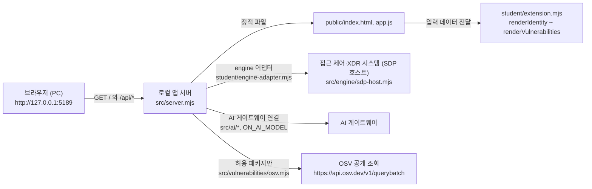

# 다이브 학생용 실행 설명서와 시스템 구성도 (21단계)

이 문서는 학생이 직접 작성한 설명서이며 제공 문서(`README.md`, `docs/STUDENT_LAUNCH_GUIDE.md` 등)를 바꾸지 않습니다. 이 문서가 들어 있는 커밋의 파일을 기준으로 쓰였고, 아래 「확인 방법」 칸에 **실제 실행**, **코드에서 확인**, **모의 입력**, **미확인**을 구분해 적었습니다. 실행하지 않은 것을 확인했다고 쓰지 않습니다. 키·토큰·비밀번호는 이 문서에 없습니다.

## 1. 목적과 기능

다이브는 회사 직원이 자기 로그인 상태, 업무 앱 접속 판정, 접속 기록·보안 경보를 보는 로컬 보안 앱입니다. 서버는 내 PC의 `127.0.0.1`에서만 열립니다. 학생은 `student/extension.mjs`의 화면 함수 8개를 구현했습니다(6장).

| 단계 | 화면 함수 | 보여 주는 것 |
|---|---|---|
| 13 | `renderIdentity` | 로그인 사용자·기기·세션 |
| 14 | `renderDecision` | 업무 앱 접근 판정과 이유 |
| 15 | `renderEvents` | 접속 기록·XDR 경보 목록, 필터, 상세 |
| 16 | `renderStatus` | 알림·빈 상태·오류·도움정보 복사 |
| 17 | `renderAiConnection` | AI 연결 점검 상태 |
| 18 | `renderExplanation` | 근거에 연결된 AI 사건 설명(참고용) |
| 19 | `renderAction` | 조치 요청 상태와 실제 효과 관측 구분 |
| 20 | `renderVulnerabilities` | 설치 패키지 정확한 버전과 OSV 조회 결과 |

## 2. 지원 환경과 확인한 버전

| 항목 | 값 | 확인 방법 |
|---|---|---|
| 운영체제 | Windows(PowerShell 실행 도구 사용). macOS·Linux는 지원 대상이 아님 | 코드에서 확인(`tools/*.ps1`) |
| Node.js | 이 문서를 쓴 PC는 `v24.20.0`. 수업·검수 기준은 `24.19.0`, 실행 도구는 22~24를 허용 | 실제 실행(`node --version`) / 코드에서 확인(`tools/start-alekov.ps1`) |
| npm | `11.19.0` | 실제 실행(`npm --version`) |
| PowerShell | Windows PowerShell | 코드에서 확인(`-File .\tools\start-alekov.ps1`). 버전 번호는 미확인 |
| 외부 npm 의존성 | 없음. `npm install`이 필요 없음 | 코드에서 확인(`package.json`에 `dependencies` 없음) |
| 브라우저 | 이 PC의 브라우저로 `http://127.0.0.1:5189`를 엽니다. 종류·버전은 미확인 | 미확인 |

Node.js가 `v24.19.0`이 아니면 실행 도구가 "참고: 지금 Node.js 는 v24.20.0 입니다. 수업 기준은 v24.19.0 입니다."라고 알려 주고 계속 실행합니다(실제 출력으로 확인).

## 3. 폴더 구조

앱 폴더는 저장소를 받은 폴더(`package.json`이 있는 폴더)이며 이 문서에서는 `<앱 폴더>`로 씁니다. 저장소: `https://github.com/shk12170-dev/ALEPH-WORKBENCH_4flour`. 특정 PC의 절대 경로에 의존하지 않습니다.

| 경로 | 역할 | 작성 |
|---|---|---|
| `student/extension.mjs` | 화면 함수 8개(`renderIdentity`~`renderVulnerabilities`)와 `createStudentView()` | **학생** |
| `student/engine-adapter.mjs` | 접근 제어·XDR 시스템과의 연결 자리(기본은 `evidenceMode: 'disconnected'`) | 제공(학생이 바꾸지 않음) |
| `docs/STUDENT_RUNBOOK.md` | 이 문서 | **학생** |
| `src/server.mjs` | 로컬 앱 서버. 정적 화면과 `/api/*` 제공 | 제공 |
| `src/engine.mjs`, `src/engine/` | 엔진 어댑터 로딩, SDP 호스트 연결 | 제공 |
| `src/ai/`, `src/connection/`, `src/learner-support/` | AI 게이트웨이 연결, 계정 연결, 도움정보 | 제공 |
| `src/actions/` | 조치 준비·전달·결과 조회 서버 쪽 | 제공 |
| `src/vulnerabilities/` | `package-lock.json` 읽기와 OSV 조회 | 제공 |
| `public/` | 브라우저 화면(`index.html`, `app.js`, `vulnerabilities-view.mjs`, `style.css`) | 제공 |
| `tools/start-alekov.ps1` | 실행 도구(Node 버전·폴더·포트 확인 뒤 서버 실행) | 제공 |
| `.env.example` | 비밀 없는 설정 견본 | 제공 |
| `docs/` 나머지 | 제공 안내 문서 | 제공 |

## 4. 실행·종료·재실행

**PowerShell을 여는 위치**: 앱 폴더(`package.json`이 있는 폴더).

```powershell
cd <앱 폴더>
powershell -NoProfile -ExecutionPolicy Bypass -File .\tools\start-alekov.ps1
```

- 포트를 바꾸려면 `-Port 5190`, 창 없이 켜려면 `-Background`, 켜짐 확인을 더 기다리려면 `-WaitSeconds 30`을 붙입니다.
- `npm start`는 서버만 직접 실행합니다(`package.json`의 `start`). `npm run demo`는 예제 자료 화면이며 실제 연결이 아닙니다. `npm run check`는 `student/extension.mjs`의 문법만 확인합니다.
- `-ExecutionPolicy Bypass`는 이 실행 한 번에만 적용됩니다.

**브라우저 주소**: `http://127.0.0.1:5189` (포트를 바꿨다면 그 포트).

**정상 시작 신호**

| 신호 | 내용 | 확인 방법 |
|---|---|---|
| 서버 시작 줄 | `케셰브 연결 확인: http://127.0.0.1:<포트>` (`--demo`이면 `케셰브 예제: ...`) | 실제 실행으로 확인(포트 5203·5204) |
| 주소 응답 | `GET /` → 200, `text/html; charset=utf-8` | 실제 실행으로 확인(포트 5201) |
| 서버 점검 | `GET /api/diagnostics` → 200, `component: on-client`, `engine.mode: disconnected`, `engine.code: ENGINE_NOT_CONNECTED` | 실제 실행으로 확인(포트 5201) |
| 실행 도구 안내 | `케셰브가 켜졌습니다. 브라우저에서 http://127.0.0.1:<포트>/ 을 여세요.` | 코드에서 확인. 실행 도구 출력 전체는 읽지 못해 이 줄은 미확인 |

`engine.mode: disconnected`는 이 실행이 실제 회사 시스템(접근 제어·XDR)에 연결되지 않았다는 뜻이며 오류가 아닙니다. 실행 도구는 서버가 응답한 것만 확인하고 AI 연결 성공을 뜻하지 않습니다.

**종료**
- 일반 실행: 실행한 PowerShell 창에서 `Ctrl+C`. 확인 방법: 미확인(대화형 창에서 시험하지 않음).
- `-Background` 실행: 화면에 안내된 「프로세스 번호」의 `node`를 작업 관리자에서 종료합니다. 확인 방법: 이 PC에서 5201 포트의 서버 프로세스를 강제 종료한 뒤 그 포트에서 대기하는 서버가 없는 것을 확인했습니다(실제 실행). 작업 관리자 화면 조작 자체는 미확인입니다.

**재실행**: 같은 폴더에서 위 명령을 다시 실행합니다. 이 실행 도구는 다른 프로그램을 종료하거나 파일을 바꾸지 않습니다(코드에서 확인).

## 5. 시스템 구성도

### Mermaid



### 글로 쓴 구성도

```text
[브라우저] --127.0.0.1 로컬 연결--> [로컬 앱 서버: src/server.mjs]
                                          |-- 정적 화면: public/ (제공)
                                          |     `-- 제공 화면이 입력 데이터를 만들어 student/extension.mjs 의
                                          |         화면 함수에 전달하고, 학생 함수가 돌려준 글자를 칸에 표시
                                          |-- /api/me, /api/devices, /api/sessions, /api/apps,
                                          |   /api/access, /api/events  --> [접근 제어·XDR 시스템(SDP 호스트)]
                                          |        (student/engine-adapter.mjs 를 거침. 기본 실행은 연결 안 됨)
                                          |-- /api/ai/check, /api/ai/explain --> [AI 게이트웨이]
                                          |        (기본 실행은 설정 안 됨: ai.configured = false)
                                          |-- /api/actions/prepare|execute|result --> 조치 처리 서버 쪽(src/actions/)
                                          |        (지원 조치가 없으면 실제 처리 경로가 열리지 않음)
                                          `-- /api/vulnerabilities --> [OSV 공개 조회]
                                                   (허용 패키지 목록이 비면 외부 조회를 하지 않음)
```

위 구성도에서 각 `/api/*` 경로가 어느 연결로 이어지는지는 서버 경로 목록(`src/server.mjs`)과 파일 이름·머리말 주석을 읽고 정리한 것입니다. 실제 연결을 켜서 확인한 것은 아닙니다(7장 참고).

### 표로 쓴 구성도

| 구성 요소 | 파일·주소 | 맡은 일 | 이 실행에서의 상태 |
|---|---|---|---|
| 브라우저 | `http://127.0.0.1:5189` | 화면 표시, 버튼 조작 | 실제 화면 확인은 미확인 |
| 로컬 앱 서버 | `src/server.mjs` | 화면 제공, `/api/*` 처리, `127.0.0.1`에서만 대기 | 실제 실행으로 응답 확인 |
| 학생 화면 함수 | `student/extension.mjs` | 서버가 준 값을 글자로 표시 | 모의 입력으로 점검(7장) |
| 접근 제어·XDR 시스템 | `src/engine/sdp-host.mjs`, `student/engine-adapter.mjs` | 본인·기기·업무 앱 판정·보안 기록 | **연결 안 됨**(`ENGINE_NOT_CONNECTED`) |
| AI 게이트웨이 | `src/ai/` | 앱 안 AI 연결 점검·사건 설명 | **설정 안 됨**(`ai.configured: false`) |
| OSV 공개 조회 | `src/vulnerabilities/` | 허용된 공개 패키지의 취약점 조회 | 허용 목록이 비어 조회하지 않음(코드에서 확인) |

## 6. 구현한 함수와 제공 코드의 경계

| 구분 | 내용 |
|---|---|
| **학생이 작성** | `student/extension.mjs`의 `renderIdentity`, `renderDecision`, `renderEvents`(상세 영역의 미지원 조치 안내 포함), `renderStatus`(도움정보 복사 버튼 포함), `renderAiConnection`, `renderExplanation`, `renderAction`, `renderVulnerabilities`, `createStudentView`. 이 문서 |
| **제공(수정하지 않음)** | `src/` 전체, `public/` 전체, `tools/`, `vendor/`, `student/engine-adapter.mjs`, `docs/`의 제공 문서 |
| **경계** | 제공 화면이 서버에서 값을 가져와 검증하고 학생 함수에 전달합니다. 학생 함수는 값을 글자로 표시하기만 하며, 서버를 직접 호출하거나 조치 요청을 보내지 않습니다. 확인 번호·토큰은 학생 코드에 전달되지 않습니다 |
| **엔진 출처** | 접근 제어·XDR 연결은 제공 엔진 코드(`src/engine/`)이며 학생이 만든 것이 아닙니다 |

| 함수 | 확인 방법 |
|---|---|
| `renderStatus`, `renderEvents` 상세(16단계) | 모의 DOM으로 점검(미지원 조치 이름 길이 경계 포함) |
| `renderExplanation`(18단계) | 모의 DOM으로 점검(근거 연결·unknown·거부 사례) |
| `renderAction`(19단계) | 모의 DOM으로 점검(상태별 문장·현재 사건·조치 결속) |
| `renderVulnerabilities`(20단계) | 모의 DOM으로 점검(상태 5종·버전 범위 거부) |

위 점검은 모두 모의 입력이며 서버의 단계 판정 결과를 뜻하지 않습니다. 단계 통과 여부는 이 문서에 적지 않습니다.
| `renderIdentity`, `renderDecision`, `renderAiConnection`(13·14·17단계) | 호출 가능 여부만 모의 DOM으로 확인. 화면 동작은 미확인 |

## 7. 확인한 기능과 미확인 기능

| 항목 | 상태 | 근거 |
|---|---|---|
| `npm run check` 문법 검사 | **확인** | 실제 실행, 종료 코드 0 |
| 서버 시작(기본·`--demo`)과 시작 줄 | **확인** | 실제 실행으로 줄을 읽음 |
| `GET /`, `GET /api/diagnostics` 응답 | **확인** | 실제 실행(포트 5201), 상태 200 |
| 포트 사용 중일 때의 안내 | **확인** | 실제 실행 출력: 「포트 … 를 다른 프로그램이 쓰고 있습니다 … -Port …」 |
| Node 버전이 수업 기준과 다를 때의 참고 안내 | **확인** | 실제 실행 출력 |
| 화면 함수의 상태별 표시 | **모의 입력으로 점검** | 모의 DOM, 실제 브라우저 아님 |
| 실제 브라우저 화면(학생 칸 8개·「다시 불러오기」·「설치 패키지 조회」·「도움정보 불러오기」) | **확인(일부)** | 22단계 재현에서 Claude 데스크톱 앱 내장 브라우저로 확인(연결 없는 기본 실행 상태). 자세한 값은 `docs/STUDENT_RELEASE_RECORD.md` 4장. 다른 브라우저는 미확인 |
| 「도움정보 복사」의 실제 복사 | **미확인** | 내장 브라우저가 클립보드를 거부해 안내와 예비 표시 칸(여섯 항목)이 나오는 것까지만 확인. 클립보드 복사 성공은 확인하지 못함 |
| `-Demo`·`npm run demo` 화면 | **미확인** | 시작 줄만 확인 |
| 접근 제어·XDR 시스템 연결(`-SdpHostConfig`) | **미확인** | 연결 설정은 운영자가 준비하며 이 실행에서는 연결하지 않음 |
| AI 게이트웨이 연결·사건 설명·모델 점검 | **미확인** | `ai.configured: false`. 실제 AI 요청은 보내지 않음 |
| 실제 OSV 조회 | **미확인** | 허용 패키지 목록이 비어 조회하지 않음 |
| 조치 준비·집행·결과 재조회 | **미확인** | 지원 조치가 없어 경로가 열리지 않음. 시험 삼아 집행하지 않음 |
| Node 22·23, macOS, Linux, 다른 브라우저 | **미확인** | 시험하지 않음 |
| `.env` 파일 자동 읽기 | **미확인** | `src/server.mjs`에서 `.env`를 읽는 코드를 찾지 못했습니다. 설정은 환경변수(`ON_PORT` 등)로 지정하며 `.env.example`은 견본입니다 |

## 8. 오류별 확인 순서

| 증상·메시지 | 원인 | 확인 순서 | 복구 |
|---|---|---|---|
| 「Node.js 가 없습니다」 / 「지금 Node.js 는 vXX」 | Node 없음·지원 밖 버전(22~24 밖) | 새 PowerShell 창에서 `node --version` | Node.js 24.19.0 설치 후 새 창에서 다시 실행 |
| 「포트 5189 를 다른 프로그램이 쓰고 있습니다」 | 포트 충돌 | 같은 이름의 앱이 이미 켜져 있는지 확인 | 그 프로그램은 두고 `-Port 5190`으로 실행하고 같은 포트로 브라우저를 엽니다 |
| 「앱 폴더가 아닙니다」 / 「시작 틀 폴더가 아닙니다」 | 실행 위치가 잘못됨 | `Get-Location`, 폴더에 `package.json`·`src\server.mjs`가 있는지 | 앱 폴더로 이동해 다시 실행 |
| 「앱 서버가 N 초 안에 뜨지 않았습니다」 | 서버가 시작하지 못함 | 같은 창의 오류 줄, `npm run check`, `node src/server.mjs`를 직접 실행해 첫 오류 확인 | 첫 오류를 해결하고 다시 실행. 느린 PC는 `-WaitSeconds 60` |
| `ENGINE_NOT_CONNECTED` / 화면의 「연결 없음(disconnected)」 | 접근 제어·XDR 시스템에 연결하지 않고 켬 | `/api/diagnostics`의 `engine.mode` | 오류가 아닙니다. 연결은 운영자가 안내한 경우에만 설정 파일로 켭니다 |
| `ai.configured: false`, `ON_AI_PROVISIONING_PENDING`, `MODEL_NOT_CONFIGURED` | AI 연결·권한·모델 설정이 준비되지 않음 | 화면 AI 연결 칸의 오류 분류(`renderAiConnection`) | 운영자 확인 요청. 다른 열쇠를 복사해 넣지 않습니다 |
| 패키지 조회가 `not_configured`·`not_checked` | 조회 대상 프로젝트 설정 또는 허용 패키지 없음 | 화면의 조회 상태 문구 | 정상 상태일 수 있으며 허용 목록은 운영자가 준비합니다(`ON_PROJECT_DIRECTORY`, `ON_APPROVED_PUBLIC_PACKAGES`). 취약점이 없다는 뜻이 아닙니다 |
| `INVALID_PUBLIC_PACKAGE_LIST` | 허용 패키지 설정 형식 오류 | `ON_APPROVED_PUBLIC_PACKAGES`가 JSON 배열인지 | 값을 고치거나 `[]`로 두고 다시 실행 |
| `SDP_HOST_DEMO_CONFLICT`, `ACTION_STARTUP_CONFLICT` | 실행 옵션 조합 충돌(`-Demo`와 SDP 설정 등) | 사용한 옵션 목록 | 옵션을 줄여 다시 실행 |
| 화면에 「조회 실패」·시간 초과·네트워크 오류 | 서버 응답 지연 | 화면의 오류 코드 | 위쪽 「다시 불러오기」를 직접 누릅니다. 자동으로 다시 요청하지 않습니다 |
| 그 밖의 코드 | | `docs/CONNECTION_TROUBLESHOOT.md`의 오류 코드 표 | 표의 다시 시도 조건을 따릅니다 |

## 9. 보안·제출 시 지킬 것

- 키·토큰·비밀번호는 코드·문서·커밋·캡처·도움정보에 넣지 않습니다. 환경변수나 제출에서 빠지는 파일에만 둡니다.
- 로컬 서버는 `127.0.0.1`에서만 대기하며 다른 PC에서 접속하는 환경은 지원하지 않습니다.
- 21·22단계는 제출 화면에 저장소 주소와 **40자리 커밋**을 직접 입력합니다. 서버의 AI는 제출한 커밋의 파일을 읽을 뿐 문서의 명령을 실행하지 않습니다.
- 실제 AI 요청·보안 조치·단계 제출은 사용자가 직접 합니다.
